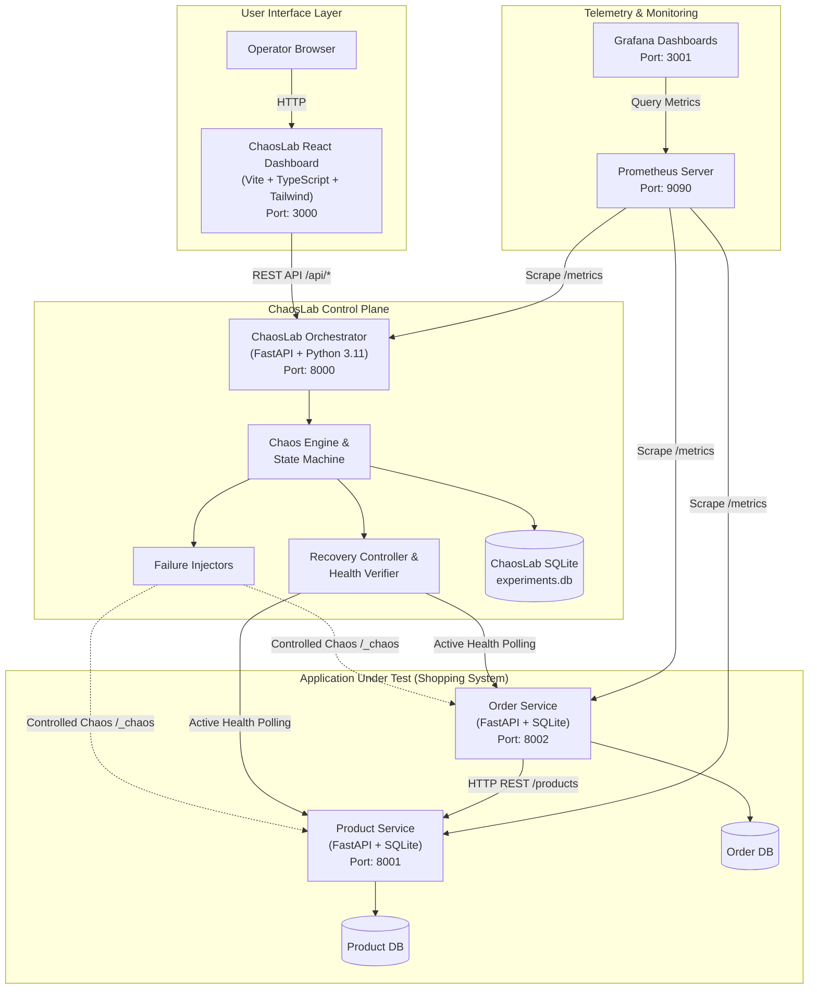

# ChaosLab – Automated Failure Injection & Recovery Platform

[](https://github.com/)
[](https://fastapi.tiangolo.com/)
[](https://react.dev/)
[](https://www.docker.com/)
[](https://prometheus.io/)
[](https://grafana.com/)
[](https://www.jenkins.io/)
[](https://docs.pytest.org/)

> **Notice:** All failures injected within ChaosLab are strictly controlled, bounded, and targeted at an isolated educational testing environment. No real production services or host machine operating systems are touched.

---

## Table of Contents

1. [Project Overview](#1-project-overview)
2. [Problem Statement & Objectives](#2-problem-statement--objectives)
3. [System Architecture](#3-system-architecture)
4. [Technology Stack & Compatible Versions](#4-technology-stack--compatible-versions)
5. [Project Folder Structure](#5-project-folder-structure)
6. [Prerequisites & System Requirements](#6-prerequisites--system-requirements)
7. [Installation & Setup on Windows / WSL2](#7-installation--setup-on-windows--wsl2)
8. [Configuration (.env)](#8-configuration-env)
9. [Running ChaosLab](#9-running-chaoslab)
   - [Option A: Running with Docker Compose (Recommended)](#option-a-running-with-docker-compose-recommended)
   - [Option B: Running Locally without Docker](#option-b-running-locally-without-docker)
10. [Application Under Test (Online Shopping System)](#10-application-under-test-online-shopping-system)
11. [Controlled Chaos Experiments Guide](#11-controlled-chaos-experiments-guide)
12. [Failure Detection, Automated Recovery & Telemetry](#12-failure-detection-automated-recovery--telemetry)
13. [Experiment Metrics & Calculation Math](#13-experiment-metrics--calculation-math)
14. [REST API Documentation & Example Requests](#14-rest-api-documentation--example-requests)
15. [Prometheus & Grafana Observability](#15-prometheus--grafana-observability)
16. [Jenkins CI/CD Pipeline Setup](#16-jenkins-cicd-pipeline-setup)
17. [Automated Testing Suite](#17-automated-testing-suite)
18. [Troubleshooting Guide](#18-troubleshooting-guide)
19. [Limitations & Future Enhancements](#19-limitations--future-enhancements)

---

## 1. Project Overview

**ChaosLab** is a full-stack, automated chaos engineering and resilience testing platform designed as an end-to-end college DevOps capstone project. Inspired by principles from Netflix Chaos Monkey and site reliability engineering (SRE) practices, ChaosLab allows engineers and students to intentionally inject controlled failures into microservices, observe real-time health degradation, trigger automated recovery strategies, and mathematically quantify Mean Time to Detect (MTTD), Mean Time to Recover (MTTR), and total downtime.

---

## 2. Problem Statement & Objectives

### The Problem
Modern distributed systems fail in unpredictable ways: containers crash, dependencies become partitioned, CPU hotspots starve critical paths, and memory leaks lead to cascading outages. Traditional unit and integration tests only verify software behavior under pristine conditions—they do not validate how the system detects, mitigates, and recovers from transient infrastructural failures.

### Project Objectives
1. **Application Under Test:** Implement a realistic microservices architecture composed of a **Product Service** (catalog & stock reservation) and an **Order Service** (order creation & dependency coordination).
2. **Controlled Perturbation:** Provide safe, bounded failure injection mechanisms covering container failure, CPU stress, memory pressure, dependency partitions, and network latency.
3. **Automated Detection Loop:** Implement background health polling to capture the exact timestamp when a failure degrades service health.
4. **Verified Self-Healing Recovery:** Execute targeted recovery controllers (container restarts, stress relief, dependency restoration) and verify health restoration using active probe polling rather than assuming recovery succeeded.
5. **Precise Telemetry:** Calculate detection duration, recovery duration, and downtime from real timestamps.
6. **Observability & Dashboards:** Provide both an interactive React frontend dashboard and production-grade Prometheus + Grafana telemetry.
7. **Automated CI/CD:** Deliver a Jenkins pipeline for testing, Docker building, and optional resilience validation.

---

## 3. System Architecture



---

## 4. Technology Stack & Compatible Versions

| Component | Technology | Version | Purpose |
| :--- | :--- | :--- | :--- |
| **Frontend** | React, Vite, Tailwind CSS | React 18.3, Vite 5.4, Tailwind 3.4 | Dark-navy engineering dashboard & controls |
| **Backend API** | Python, FastAPI, Uvicorn | Python 3.11, FastAPI 0.162, Uvicorn 0.54 | Chaos orchestration, state machine & REST API |
| **Microservices** | Python, FastAPI, SQLite | Python 3.11, FastAPI 0.162 | Product Service (8001) & Order Service (8002) |
| **Containerization** | Docker, Docker Compose | Compose file format v3.8 | Multi-container isolation & resource boundaries |
| **Telemetry** | Prometheus | `v2.50.1` | Time-series metrics collection |
| **Visualization**| Grafana | `v10.3.3` | Pre-provisioned dashboards & telemetry graphs |
| **Testing** | Pytest, pytest-asyncio | Pytest 9.2, pytest-asyncio 1.4 | Automated unit, API & lifecycle testing |
| **CI/CD** | Jenkins Pipeline | Declarative Jenkinsfile | Linting, test execution, image build & resilience test |

---

## 5. Project Folder Structure

```text
chaosLab/
├── .env.example                          # Environment variable template
├── .gitignore                            # Standard git exclusions
├── docker-compose.yml                    # Multi-container orchestration
├── Jenkinsfile                           # Root CI/CD pipeline entrypoint
├── requirements.txt                      # Complete Python dependencies
├── README.md                             # Comprehensive project documentation
├── backend/                              # ChaosLab Control Plane
│   ├── Dockerfile
│   ├── requirements.txt
│   ├── config.py                         # Settings & safety thresholds
│   ├── database.py                       # SQLite persistence layer
│   ├── models.py                         # Experiment schema & queries
│   ├── schemas.py                        # Pydantic models & validation rules
│   ├── main.py                           # FastAPI application entrypoint
│   ├── chaos/
│   │   ├── __init__.py
│   │   ├── docker_client.py              # Safe Docker interaction & allowlisting
│   │   ├── engine.py                     # Chaos state machine & metrics calculator
│   │   ├── injectors.py                  # Failure injection handlers
│   │   └── recovery.py                   # Automated recovery & verified health loop
│   ├── routers/
│   │   ├── __init__.py
│   │   ├── dashboard.py                  # Dashboard summary & analysis endpoints
│   │   ├── experiments.py                # Experiment trigger, cancel, list, details
│   │   └── services.py                   # Service registry & health endpoints
│   └── tests/
│       ├── __init__.py
│       ├── test_api.py                   # API integration tests
│       ├── test_chaos_lifecycle.py       # State machine & cancellation tests
│       ├── test_metrics_calculation.py   # Telemetry duration & downtime tests
│       └── test_validation.py            # Safety constraints & input validation
├── services/
│   ├── product_service/                  # Product Catalog Microservice (Port 8001)
│   │   ├── Dockerfile
│   │   ├── requirements.txt
│   │   ├── database.py                   # SQLite catalog storage & sample seeding
│   │   ├── models.py                     # Product & reservation models
│   │   ├── main.py                       # REST API, metrics, & chaos hooks
│   │   └── tests/
│   │       └── test_product_service.py   # Product service test suite
│   └── order_service/                    # Order Processing Microservice (Port 8002)
│       ├── Dockerfile
│       ├── requirements.txt
│       ├── database.py                   # SQLite order storage
│       ├── models.py                     # Order models & items
│       ├── main.py                       # REST API, dependency calls, & chaos hooks
│       └── tests/
│           └── test_order_service.py     # Order service test suite
├── frontend/                             # React + Vite Dashboard (Port 3000)
│   ├── Dockerfile                        # Multi-stage production container build
│   ├── nginx.conf                        # Nginx reverse proxy configuration
│   ├── package.json
│   ├── vite.config.ts
│   ├── tsconfig.json
│   ├── tailwind.config.js
│   ├── postcss.config.js
│   ├── index.html
│   └── src/
│       ├── main.tsx
│       ├── App.tsx                       # Main dashboard state & auto-polling
│       ├── api.ts                        # Typed REST API client
│       ├── types.ts                      # Shared TypeScript data models
│       ├── styles/
│       │   └── index.css                 # Tailwind directives & theme
│       └── components/
│           ├── Navbar.tsx                # Brand header & quick navigation
│           ├── MetricCard.tsx            # Styled telemetry KPI card
│           ├── OverviewSection.tsx       # Live status banner & stepper tracker
│           ├── ServiceHealthSection.tsx  # Service health & dependency cards
│           ├── FailureInjectionSection.tsx # Experiment cards & parameter sliders
│           ├── FailureConfirmationModal.tsx # Safety confirmation modal
│           ├── ExperimentHistorySection.tsx # Filterable audit log table
│           ├── ExperimentDetailModal.tsx # Full timestamp trace modal
│           └── RecoveryAnalysisSection.tsx # MTTR comparative charts
├── monitoring/
│   ├── prometheus/
│   │   └── prometheus.yml                # Telemetry scrape configuration
│   └── grafana/
│       ├── datasources/
│       │   └── datasource.yml            # Automatic Prometheus datasource binding
│       └── dashboards/
│           ├── dashboard.yml             # Dashboard provider configuration
│           └── chaoslab-dashboard.json   # Pre-built resilience monitoring dashboard
├── ci/
│   └── Jenkinsfile                       # Declarative multi-stage Jenkins pipeline
└── scripts/
    ├── run_local.ps1                     # Windows PowerShell local runner
    ├── run_local.sh                      # Linux/macOS bash local runner
    ├── run_tests.ps1                     # Windows test suite runner
    └── run_tests.sh                      # Linux test suite runner
```

---

## 6. Prerequisites & System Requirements

- **Operating System:** Windows 10/11 (with Docker Desktop and WSL2) OR Linux (Ubuntu 20.04+) OR macOS.
- **Python:** Python 3.11.x installed.
- **Node.js:** Node.js v20.x or v22.x with `npm`.
- **Docker:** Docker Desktop with Docker Compose v2.x enabled.
- **Hardware:** Minimum 4 GB RAM, 2 CPU cores, 5 GB free disk space.

---

## 7. Installation & Setup on Windows / WSL2

### Step 1: Clone Repository
```powershell
git clone https://github.com/your-username/chaosLab.git
cd chaosLab
```

### Step 2: Set Up Python Virtual Environment
```powershell
python -m venv .venv
.\.venv\Scripts\Activate.ps1
python -m pip install --upgrade pip
pip install -r requirements.txt
```

### Step 3: Set Up Frontend Dependencies
```powershell
cd frontend
npm install
cd ..
```

### Step 4: Docker Desktop & WSL2 Configuration (When using Docker)
1. Open Docker Desktop Settings -> **General** -> Enable **Use the WSL 2 based engine**.
2. Under **Resources** -> **WSL Integration**, enable integration with your default WSL2 distribution.
3. Ensure Docker service is running by testing in PowerShell:
   ```powershell
   docker --version
   docker compose version
   ```

---

## 8. Configuration (.env)

Copy `.env.example` to create `.env`:
```powershell
Copy-Item .env.example .env
```

Key environment configuration variables:
```bash
# ChaosLab Control Plane
CHAOSLAB_PORT=8000
CHAOSLAB_HOST=0.0.0.0
CHAOSLAB_DB_PATH=chaoslab.db

# Target Microservice Endpoints
PRODUCT_SERVICE_URL=http://product-service:8001
ORDER_SERVICE_URL=http://order-service:8002

# Local Development Endpoints (uncomment when running outside Docker)
# PRODUCT_SERVICE_URL=http://localhost:8001
# ORDER_SERVICE_URL=http://localhost:8002

# Polling and Recovery Guardrails
HEALTH_CHECK_INTERVAL_SECONDS=1.5
RECOVERY_TIMEOUT_SECONDS=30.0
DETECTION_TIMEOUT_SECONDS=25.0

# Safety Guardrails
MAX_EXPERIMENT_DURATION_SECONDS=60
MAX_CPU_LOAD_PERCENT=80
MAX_MEMORY_MB=350
ALLOWED_TARGET_SERVICES=product-service,order-service
```

---

## 9. Running ChaosLab

### Option A: Running with Docker Compose (Recommended)

Start all containers in detached mode:
```powershell
docker compose up --build -d
```

Verify running containers:
```powershell
docker compose ps
```

Stop the platform when done:
```powershell
docker compose down
```

### Option B: Running Locally without Docker

ChaosLab features native HTTP-based simulation hooks, allowing full functionality even on systems without Docker running!

**On Windows (PowerShell):**
```powershell
powershell -ExecutionPolicy Bypass -File .\scripts\run_local.ps1
```

**On Linux / macOS / WSL2:**
```bash
chmod +x ./scripts/run_local.sh
./scripts/run_local.sh
```

### Accessing the Web Interfaces

| Interface | Local URL | Credentials / Notes |
| :--- | :--- | :--- |
| **ChaosLab Dashboard** | [http://localhost:3000](http://localhost:3000) | Dark-navy web UI for failure injection & history |
| **Backend API (Swagger)**| [http://localhost:8000/docs](http://localhost:8000/docs) | Interactive OpenAPI / Swagger UI |
| **Prometheus Telemetry** | [http://localhost:9090](http://localhost:9090) | Metric queries and scrape targets |
| **Grafana Dashboards**   | [http://localhost:3001](http://localhost:3001) | User: `admin` / Password: `chaoslab` |
| **Product Service**      | [http://localhost:8001/products](http://localhost:8001/products) | Product Catalog REST API |
| **Order Service**        | [http://localhost:8002/orders](http://localhost:8002/orders) | Order Processing REST API |

---

## 10. Application Under Test (Online Shopping System)

The system under test represents an online shopping checkout flow consisting of two microservices:

### 1. Product Service (Port 8001)
- **Database:** SQLite (`products.db`) pre-seeded with 6 electronic accessories.
- **REST APIs:**
  - `GET /products`: List all catalog products.
  - `GET /products/{id}`: Product details and stock level.
  - `POST /products/{id}/reserve`: Reserve inventory during checkout.
  - `POST /products/{id}/release`: Release inventory if order fails.
  - `GET /health`: Operational health check.
  - `GET /metrics`: Prometheus telemetry metrics.

### 2. Order Service (Port 8002)
- **Database:** SQLite (`orders.db`) storing confirmed orders and items.
- **REST APIs:**
  - `GET /orders`: List order history.
  - `GET /orders/{id}`: Detailed order summary.
  - `POST /orders`: Creates an order by validating stock and reserving inventory from Product Service.
  - `GET /health`: Microservice health check verifying both local database and downstream connectivity to Product Service.
  - `GET /metrics`: Prometheus telemetry metrics.

---

## 11. Controlled Chaos Experiments Guide

| Experiment Type | Safe Target Services | Configurable Parameters | Description |
| :--- | :--- | :--- | :--- |
| **Container Failure** | `product-service`, `order-service` | Duration (5s–60s) | Terminates the test container or process. Triggers automated restart and health verification. |
| **CPU Stress** | `product-service`, `order-service` | Duration (5s–60s), Load (20%–80%) | Spawns worker threads performing mathematical loops, increasing request latency. |
| **Memory Stress** | `product-service`, `order-service` | Duration (5s–60s), Memory (50MB–350MB) | Allocates a bounded memory buffer inside the container without exceeding host limits. |
| **Dependency Failure** | `order-service` | Duration (5s–60s) | Simulates network partition or timeout when Order Service communicates with Product Service. |
| **Network Delay** | `product-service`, `order-service` | Duration (5s–60s), Latency (100ms–3000ms) | Introduces artificial delay to simulate slow cross-datacenter or network congestion. |

---

## 12. Failure Detection, Automated Recovery & Telemetry

ChaosLab uses a state machine to track experiment lifecycles:

```
[ PENDING ]
     │  Operator triggers experiment (requires confirm_destruction: true)
     ▼
[ INJECTING ]
     │  Failure injector triggers container stop or chaos hook
     ▼
[ RUNNING ] ───► (Failure Timestamp Recorded)
     │  Continuous background health probe ticks every 1.5s
     ▼
[ DETECTED ] ───► (Detection Timestamp Recorded: Probe receives 503/Timeout)
     │  Service held in degraded state for specified duration
     ▼
[ RECOVERING ] ───► (Recovery Start Timestamp Recorded)
     │  Recovery controller restarts container or clears chaos buffers
     ▼
[ VERIFYING ]
     │  Active polling against /health with backoff (Timeout: 30s)
     ├───► [ RECOVERED ]  (Verified Healthy Again: 200 OK + status healthy)
     └───► [ FAILED ]     (Verification timeout expired without healthy check)
```

> **Crucial Rule:** ChaosLab **never** reports a service as recovered without an explicit, successful HTTP 200 health check response.

---

## 13. Experiment Metrics & Calculation Math

ChaosLab computes resilience metrics from ISO 8601 timestamps:

### 1. Detection Time ($T_{\text{detection}}$)
The elapsed time between when the failure was injected and when the automated monitoring probe detected health degradation:
$$T_{\text{detection}} = T_{\text{detected}} - T_{\text{failure}}$$

### 2. Recovery Duration ($T_{\text{recovery}}$)
The elapsed time from when the automated recovery action was initiated until the service passed verified health checks:
$$T_{\text{recovery}} = T_{\text{verified}} - T_{\text{recovery\_start}}$$

### 3. Total Downtime ($T_{\text{downtime}}$)
The total duration the service was unavailable or degraded:
$$T_{\text{downtime}} = T_{\text{verified}} - T_{\text{failure}}$$

### Missing Timestamps Rule
If a service fails to recover within the timeout period, Recovery Duration and Total Downtime are recorded as `null` / `N/A`. The platform **never fabricates** numbers for unrecovered services.

---

## 14. REST API Documentation & Example Requests

FastAPI automatically serves interactive Swagger documentation at:
**[http://localhost:8000/docs](http://localhost:8000/docs)**

### Example 1: Trigger Controlled Container Failure
```bash
curl -X POST http://localhost:8000/api/experiments \
  -H "Content-Type: application/json" \
  -d '{
    "type": "container_failure",
    "target_service": "product-service",
    "duration_seconds": 15,
    "confirm_destruction": true
  }'
```

### Example 2: Trigger CPU Stress Workload
```bash
curl -X POST http://localhost:8000/api/experiments \
  -H "Content-Type: application/json" \
  -d '{
    "type": "cpu_stress",
    "target_service": "order-service",
    "duration_seconds": 20,
    "load_percent": 70,
    "confirm_destruction": true
  }'
```

### Example 3: Get Dashboard Summary
```bash
curl -s http://localhost:8000/api/dashboard/summary
```

### Example 4: Cancel a Running Experiment
```bash
curl -X POST http://localhost:8000/api/experiments/exp-12345678/cancel
```

---

## 15. Prometheus & Grafana Observability

### Prometheus
- **URL:** `http://localhost:9090`
- **Config:** `monitoring/prometheus/prometheus.yml`
- **Key Metrics Scraped:**
  - `product_service_health_status`: 1 = Healthy, 0 = Down/Outage
  - `order_service_health_status`: 1 = Healthy, 0 = Degraded/Down
  - `chaoslab_system_health`: Overall resilience score (2=Optimal, 1=Degraded, 0=Critical)
  - `product_service_requests_total`: Total HTTP requests counter
  - `order_service_dependency_errors_total`: Count of failed inter-service requests

### Grafana
- **URL:** `http://localhost:3001`
- **Credentials:** Username: `admin` | Password: `chaoslab`
- **Pre-provisioned Dashboard:** `ChaosLab – Resilience & Recovery Dashboard`
  - Real-time Health Stat Panels
  - Request Rate (req/sec) Time Series
  - 5xx Error Spike Graph
  - Active Chaos Indicators

---

## 16. Jenkins CI/CD Pipeline Setup

A declarative `Jenkinsfile` is provided in the repository root and `ci/Jenkinsfile`.

### How to Configure Jenkins Locally:
1. Run Jenkins locally via Docker:
   ```powershell
   docker run -d -p 8080:8080 -p 50000:50000 -v jenkins_home:/var/jenkins_home --name jenkins jenkins/jenkins:lts
   ```
2. Navigate to `http://localhost:8080`, unlock with the generated initial password, and install recommended plugins.
3. In Jenkins Dashboard -> **New Item** -> Name it `ChaosLab-Pipeline` -> Choose **Pipeline**.
4. In Pipeline configuration:
   - **Definition:** Pipeline script from SCM
   - **SCM:** Git
   - **Repository URL:** Your GitHub repo URL (e.g. `https://github.com/<username>/chaosLab.git`)
   - **Branch:** `*/main`
   - **Script Path:** `Jenkinsfile`
5. Save and click **Build Now**.

### Pipeline Stages:
1. **Checkout:** Clones code from GitHub.
2. **Install Dependencies:** Installs Python requirements in `.venv` and runs `npm ci` for frontend.
3. **Backend & Microservices Unit Tests:** Runs Pytest test suites across `services/product_service/tests`, `services/order_service/tests`, and `backend/tests`.
4. **Frontend Quality & Build Checks:** Runs TypeScript compiler check (`tsc --noEmit`) and Vite production build.
5. **Validate Docker Compose:** Executes `docker compose config` to validate syntax and dependencies.
6. **Build Docker Images:** Pre-builds production Docker images.
7. **Resilience Chaos Verification (Optional):** Triggered only when the pipeline parameter `RUN_RESILIENCE_CHAOS_TEST` is checked.

---

## 17. Automated Testing Suite

ChaosLab includes automated test suites covering all microservices, API validation, metric calculations, and the chaos lifecycle.

Run all tests on Windows:
```powershell
powershell -ExecutionPolicy Bypass -File .\scripts\run_tests.ps1
```

Run all tests on Linux/macOS:
```bash
./scripts/run_tests.sh
```

Or run Pytest directly:
```powershell
.\.venv\Scripts\python.exe -m pytest services/product_service/tests services/order_service/tests backend/tests -v
```

### Test Coverage Summary:
- **Product Service Tests (6 tests):** Health check, catalog listing, product detail retrieval, stock reservation, out-of-stock validation, simulated outage injection & recovery.
- **Order Service Tests (4 tests):** Health check, order creation with stock coordination, dependency failure handling, Prometheus metrics endpoint.
- **Backend API Tests (7 tests):** Health endpoint, Prometheus scraping, dashboard summary, recovery analysis, service registry, experiment CRUD, 404 handling.
- **Chaos Engine Lifecycle Tests (2 tests):** End-to-end async state machine execution, automated recovery verification, and mid-run cancellation.
- **Metric Calculations (4 tests):** Detection time, recovery duration, total downtime, handling missing timestamps without fabrication.
- **Validation & Security Tests (6 tests):** Requirement for explicit destruction confirmation, rejection of unauthorized services, rejection of unsupported chaos types, bounded CPU limits (max 80%), bounded memory limits (max 350MB).
- **Frontend Quality Tests:** TypeScript compiler validation and Vite production bundle generation.

---

## 18. Troubleshooting Guide

### 1. `docker compose up` fails with Docker daemon not running
- **Cause:** Docker Desktop is not started or WSL2 engine is not initialized.
- **Fix:** Launch Docker Desktop. If you prefer to test without Docker, run `scripts/run_local.ps1` to launch all services natively on `localhost`.

### 2. Microservice reports `Connection Refused` on port 8001 or 8002
- **Cause:** Service process did not start or port is occupied.
- **Fix:** Check if port 8001/8002 is in use via `netstat -ano | findstr :8001`. Kill any stale process and re-run.

### 3. Grafana dashboard displays "No Data"
- **Cause:** Prometheus has not completed its first scrape cycle (scrapes every 2s).
- **Fix:** Wait 5 seconds after starting containers or trigger an HTTP request to Product Service (`http://localhost:8001/products`) to generate metric events.

### 4. Experiment reports `Another chaos experiment is already active`
- **Cause:** A previous experiment is currently in the `RUNNING`, `DETECTED`, or `VERIFYING` state.
- **Fix:** Wait for the current experiment's auto-recovery duration to finish, or click **Cancel Experiment** in the dashboard banner to immediately restore baseline health.

---

## 19. Limitations & Future Enhancements

- **Network Packet Level Chaos:** Network latency is currently simulated via application middleware. Future releases could integrate Linux `tc` (Traffic Control) or Chaos Mesh for kernel-level packet loss and jitter simulation.
- **Multi-Node Kubernetes Support:** ChaosLab is currently optimized for single-host Docker Compose and local developer environments. A future enhancement can adapt the control plane into a Kubernetes Custom Resource Definition (CRD).
- **Distributed Tracing:** Future iterations could incorporate OpenTelemetry and Jaeger to visualize cascading latency traces through distributed call graphs.

---

## Step-by-Step Demonstration Walkthrough

Follow these steps to demonstrate container failure and recovery to an evaluator or class:

1. **Start the Platform:**
   Launch the system via Docker Compose (`docker compose up -d`) or via PowerShell (`.\scripts\run_local.ps1`).
2. **Verify Baseline Health:**
   Open [http://localhost:3000](http://localhost:3000). Both Product Service and Order Service will show green **HEALTHY** status with low response latency (< 10ms).
3. **Select a Controlled Failure:**
   Click **Failure Injection** in the top navigation. Select **Container Failure**.
4. **Configure & Confirm:**
   Choose target `product-service` and a duration of `15s`. Check the confirmation box acknowledging intentional perturbation, and click **Inject Controlled Failure**.
5. **Observe Real-Time Detection:**
   The dashboard redirects to **Overview**. The active banner pulses red. Within 1–2 seconds, the automated monitor detects `product-service` failure (status changes to **UNHEALTHY** / **503**), and records the exact **Detection Time** (e.g. ~1100ms).
6. **Observe Automated Recovery:**
   After the 15-second duration, ChaosLab initiates recovery. The status transitions to **RECOVERING** and active health checks begin polling.
7. **Verify Health Restoration:**
   Within 1–3 seconds, the health check succeeds. The status badge turns green (**VERIFIED RECOVERED**).
8. **Analyze Results:**
   Navigate to **Experiment History** or **Recovery Analysis** to inspect the mathematical breakdown of Detection Time, Recovery Duration, and Total Downtime.
